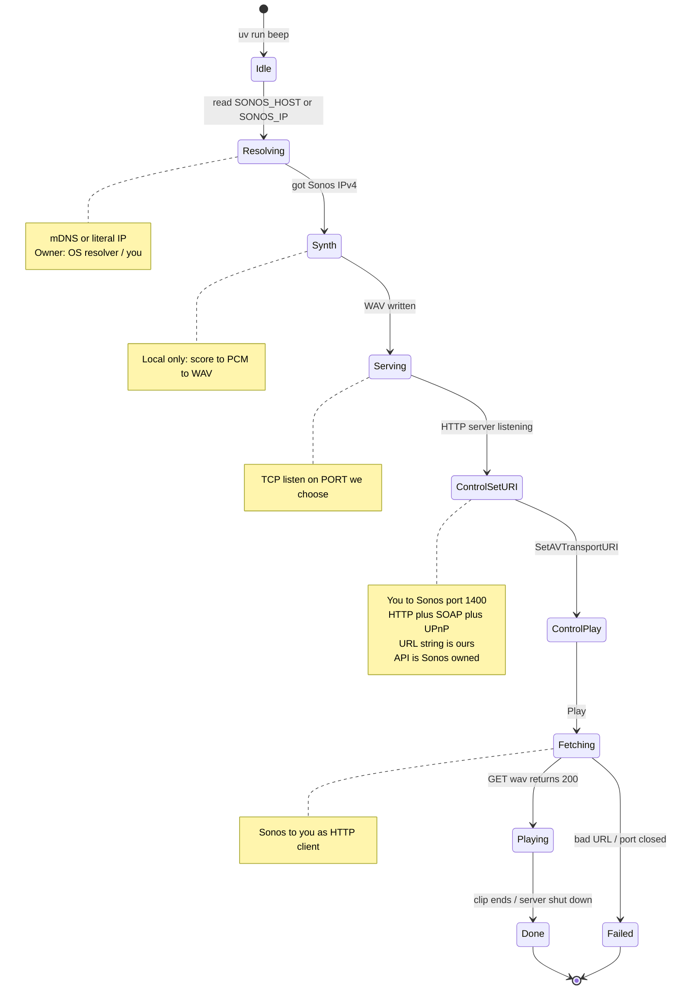
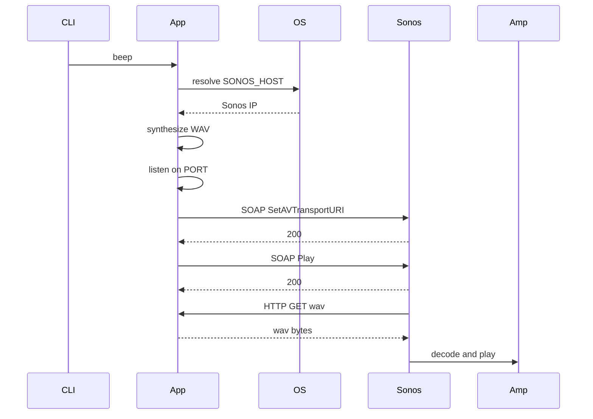

# How sonos-rasa-sayang talks to Sonos

This tool synthesizes **Rasa Sayang** as a WAV and plays it on a Sonos speaker
over the LAN. It does **not** use the Sonos cloud API. It uses the speaker’s
local **UPnP / SOAP** control interface on TCP port **1400**, plus a short-lived
HTTP file server on your machine.

## Mental model: two planes

| Plane | Direction | Role |
|-------|-----------|------|
| **Control** | You → Sonos `:1400` | “Set track URL” + “Play” + volume (HTTP + SOAP) |
| **Media** | Sonos → you `:PORT` | Sonos **pulls** the WAV with HTTP GET |

You never push PCM into the speaker on this path. You hand it a URL; **it fetches**.

```
Your computer                         Sonos
     |                                   |
     |  SOAP :1400  SetAVTransportURI    |
     |---------------------------------->|
     |  SOAP :1400  Play                 |
     |---------------------------------->|
     |      HTTP GET /rasa-sayang.wav    |
     |<----------------------------------|
     |      audio/wav bytes              |
     |---------------------------------->|  speakers
```

## Who chooses / owns each protocol

| Piece | Who chose it | Who “owns” it |
|-------|----------------|---------------|
| Wi‑Fi / Ethernet / IP / TCP / UDP | Your LAN + OS | IEEE / IETF / your network |
| mDNS (`*.local`) | We resolve `SONOS_HOST` this way | Bonjour / IETF mDNS |
| UPnP + SOAP on **:1400** | **Sonos** (native local API) | Sonos |
| HTTP for control + media fetch | Implied by UPnP / AV transport | IETF HTTP |
| Full media URL (`http://IP:PORT/file.wav`) | **This tool** builds and sends it | You, for that run |
| WAV / PCM contents | **This tool** synthesizes it | You generate; Sonos decodes |
| Play / volume commands | **This tool** | You command; Sonos executes |

**How does Sonos learn our port and URL?**  
It doesn’t discover them. `SetAVTransportURI` includes the full string, e.g.
`http://192.168.1.10:8765/rasa-sayang.wav`. Sonos parses host, port, and path,
then opens a normal HTTP client to your machine.

## State diagram



## Sequence diagram



UPnP/SOAP on port 1400 is Sonos’s API. The media URL inside
`SetAVTransportURI` is chosen by this tool.

## What if Spotify (or the Sonos app) starts playing mid-beep?

Sonos keeps **one current AV transport** per group/coordinator — roughly “what
this room is playing right now.”

When you run `beep`, we set that to our HTTP WAV URL and hit Play.

If you then start something in the Sonos app (Spotify queue, radio, another
favorite, etc.), the app issues its own transport change on the same speaker
(or group coordinator). Typically that means:

1. New `SetAVTransportURI` (or equivalent) → current URI becomes Spotify/queue  
2. Play on that source  
3. Sonos **stops** fetching / playing our WAV  

So yes: it doesn’t “pause and resume” Rasa Sayang. It **replaces** the current
source. Our HTTP server may still be running until the CLI’s wait finishes, but
Sonos is no longer pulling from it.

Same the other way: `beep` will steal the room from whatever was playing before
(Spotify, TV input in some cases, etc.) for the duration of the clip (or until
something else steals it back).

There isn’t a long-lived “Rasa Sayang session” like an AirPlay connection — just
“current URI + playing,” which any controller on the LAN can overwrite.

## UPnP / SOAP — is this documented by Sonos?

Sonos does **not** publish a friendly public manual for this local `:1400` API.
What exists:

| Source | What it is |
|--------|------------|
| `http://<sonos-ip>:1400/xml/device_description.xml` | Device-exported UPnP description (services, URLs) |
| Linked SCPD XMLs under `:1400` | Action lists for each service |
| [SoCo](https://github.com/SoCo/SoCo) | Community Python library wrapping the same SOAP calls |
| UPnP AV specs (UPnP Forum) | Generic meaning of `AVTransport` / `RenderingControl` |
| [Sonos Cloud Control API](https://developer.sonos.com/) | Official **cloud** API — different from this LAN path |

Local control is a long-standing **de facto** interface: stable enough for Home
Assistant, SoCo, and tools like this, but unsupported as a public product API.

### Services this project uses

- **`RenderingControl`** — `SetVolume`, `SetMute`  
- **`AVTransport`** — `SetAVTransportURI`, `Play`  

## Useful commands while exploring

```bash
# Browse Sonos devices on the LAN (macOS)
dns-sd -B _sonos._tcp local.

# Device description (replace with your speaker IP)
curl -s http://$SONOS_IP:1400/xml/device_description.xml | head

# Run the probe
uv run beep --ip $SONOS_IP
```

## Code map

| Module | Role |
|--------|------|
| `config.py` | Env / `.env` settings |
| `discover.py` | Host/IP → Sonos address; bind IP for the URL |
| `melody.py` | Rasa Sayang → WAV |
| `serve.py` | Temporary HTTP file server |
| `upnp.py` | SOAP helpers |
| `beep.py` | Orchestration |
| `cli.py` | CLI |

See the root [README](../README.md) for setup and environment variables.
